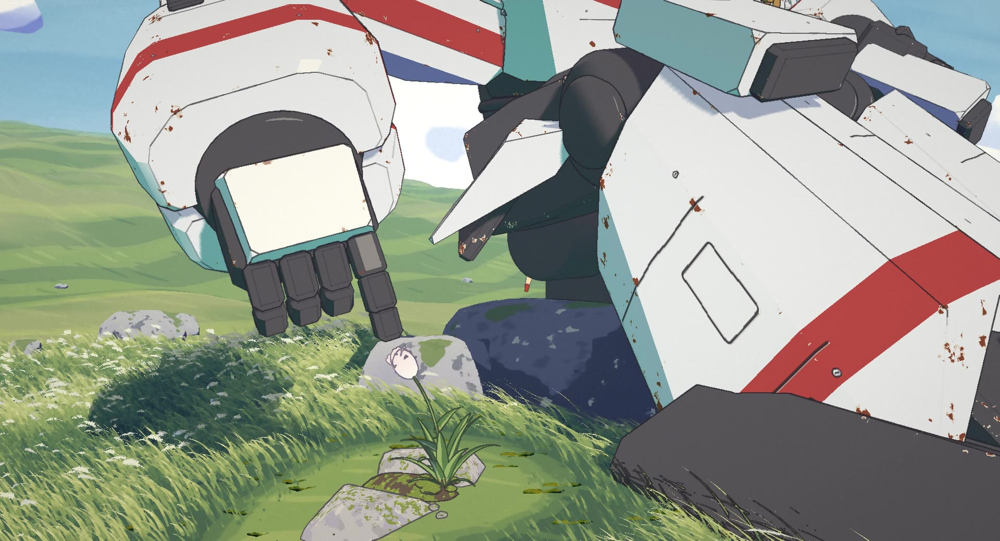
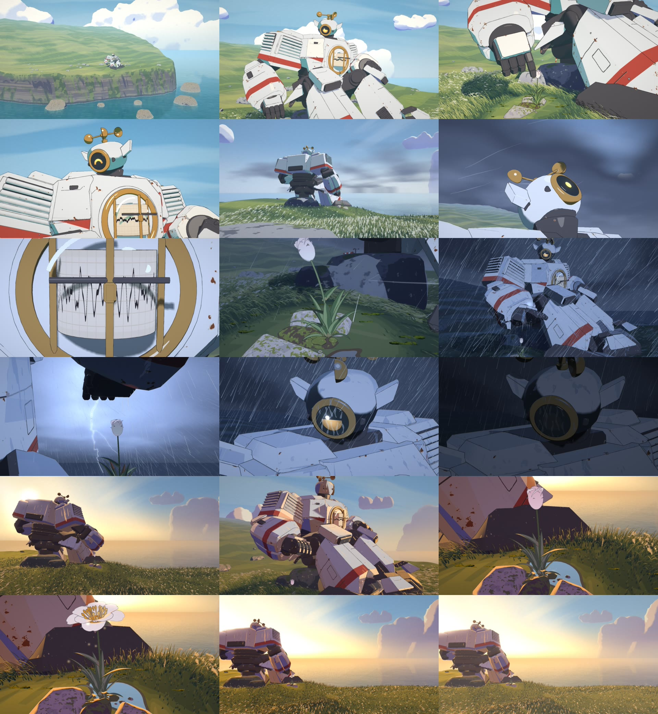
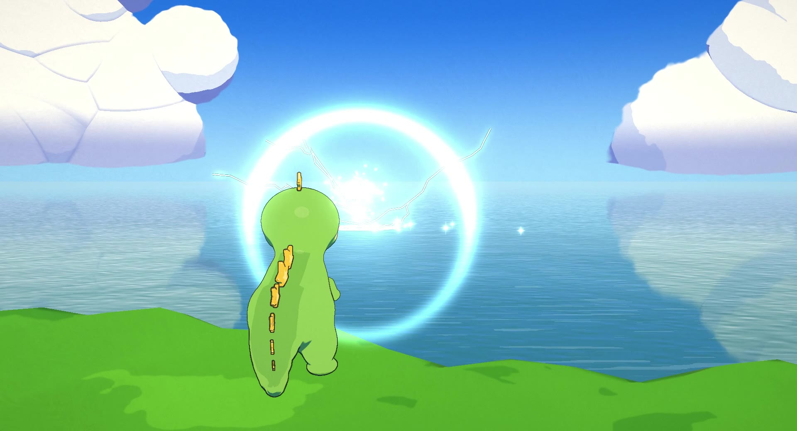
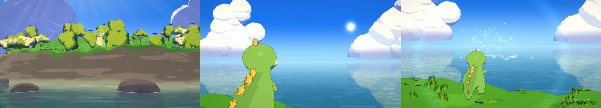
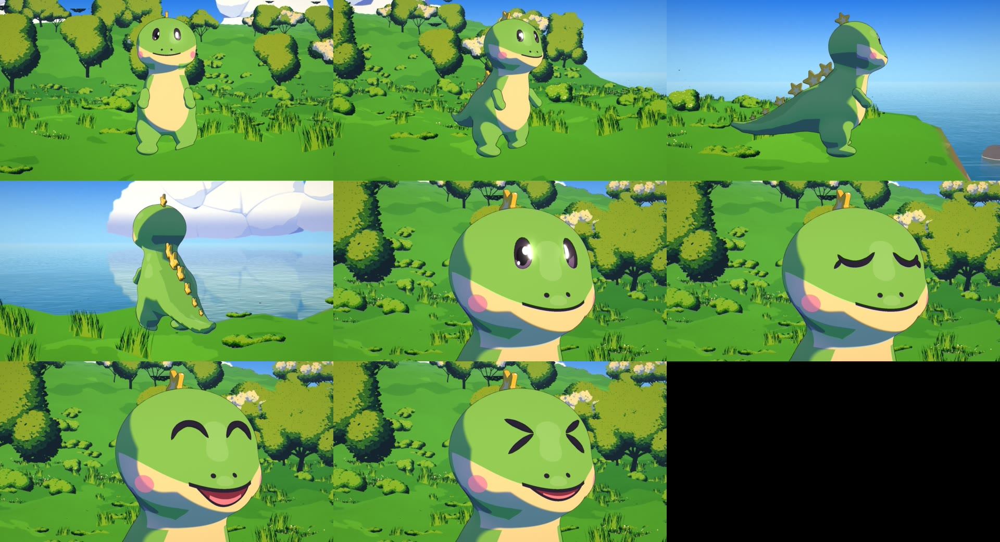

# anime-core

一个**与故事无关**的“代码渲染日式动画短片”核心引擎：three.js（WebGL2）多 pass 赛璐璐 + 水粉管线、纯函数时间轴、无状态特效、程序化配乐、无头逐帧渲染、单文件交付。

从 Sunshower / LEVIATHAN 的共用引擎（MIT，© Beyond Dev）提取、精简、加注释而来；内置两部完整的原创参考短片（8 秒有机角色短片《星のかけら》与 100 秒重型机甲长片《海岬的测风人》）。研究文档在 [`docs/`](docs/)，上手与红线看 [`docs/11_交接_长片制作.md`](docs/11_交接_长片制作.md)。

## 内置参考影片（成品画面 + 完整源码）

### 1. 《海岬的测风人》（*The Wind Keeper of the Cape*，100 秒 / 15 镜）
- **源码目录**：[`src/films/cape-keeper/`](src/films/cape-keeper/)（分镜与节拍表：[`storyboard.md`](src/films/cape-keeper/storyboard.md)）
- **看点**：硬表面机甲凸包拼装与风化贴花（[`nagi.js`](src/films/cape-keeper/nagi.js)）、360° 团块并集积云与连续水粉阴云天穹（[`sky_storm.js`](src/films/cape-keeper/sky_storm.js)）、草浪与预积分风雨场（[`world.js`](src/films/cape-keeper/world.js)、[`weather.js`](src/films/cape-keeper/weather.js)）、檐口水帘与初雨涟漪（[`fx.js`](src/films/cape-keeper/fx.js)、[`flower.js`](src/films/cape-keeper/flower.js)）、纯 JS 四幕交响配乐与自然雨滴拟音（[`score.js`](src/films/cape-keeper/score.js)）。





### 2. 《星のかけら / 星之碎片》（*Star Shard*，8 秒 / 3 镜）
- **源码目录**：[`src/story/`](src/story/)（配乐：[`src/audio/score.js`](src/audio/score.js)）
- **看点**：有机角色 SDF 平滑并集建模与 9 骨自动蒙皮（[`dino.js`](src/story/dino.js)）、程序化绘制的眼神与四种表情（[`face.js`](src/core/face.js)）、流星入水闪光与水面发光涟漪（[`fx.js`](src/story/fx.js)）。







## 产物规则（别放错地方）

| 位置 | 只放 | 判据 |
|---|---|---|
| `src/` | 代码、`films/<片名>/storyboard.md` 分镜文档 | 删掉就**没法重建**影片，或重建结果会变 |
| `out/<片名>/` | 渲染产物：`<片名>.mp4`、`soundtrack.wav`、`poster.jpg`、`snaps/` 审片静帧、`render/` 分段与哈希缓存 | 整个 `rm -rf out/` 后跑 `npm run build` 能原样再生 |
| `dist/` | 单文件播放器 `<片名>.html` | 交付物，由 `out/<片名>/<片名>.mp4` 打包而来，不手改 |

- **参考图（造型板、原作截帧）不进 `src/`**：放仓库外的参考目录（原片截帧 / 设定图），不入库，代码注释里只写名字。
- 产出**不回写** `src/`：`render.mjs` 用 `src/` 的 sha1 作分段缓存键，`src/` 混进生成物会让旧分段失效、也会让“删 `out/` 重跑”这条恢复路径失真。
- 命名跟片名走：示例片是 `star`（星のかけら）→ `out/star/star.mp4`、`out/star/soundtrack.wav`、`out/star/snaps/`、`dist/star.html`；新片 `STORY=cape-keeper`、`--name cape-keeper` → `out/cape-keeper/`。缺省片名 `film` 只用于临时试渲。

## 命令

```bash
npm install
npm run check          # 加载检查
npm run snap -- s:hill s:gaze t:4.75 --sheet review
npm run model          # 角色设定图：转面 + 表情表
npm run determinism    # 每帧必须是时间的纯函数
npm run build          # 配乐 → out/star/*.mp4 → dist/star.html
```

`--name star` / `--out dist/star.html` 已写进 `npm run render` / `npm run player` / `npm run build`，所以仓库里的产物名与命令一致。

## 怎么用

- 换故事：只改 `src/story/`（CUES、镜头、部门），`src/core/` 不动。多部片并存 → `src/films/<片名>/story.js`，浏览器 `?story=<片名>`，工具 `STORY=<片名>`。
- 角色建模两套方法：机甲/硬质零件用 `kit.js`（凸包拼装）；圆润的生物用 `organic.js`（SoftBody：SDF 平滑并集 → 一整张皮 + 自动多骨骼蒙皮），配 `face.js`（画出来的眼睛与表情）、`celMaterial({ pattern })`（着色器花纹）、`color.js`（设定色所见即所得）。
- 背景植被：`foliage.js`（手绘植物图集：22 种草木，朝镜头的卡片，一组一次绘制，受光面跟太阳自动镜像）。
- 随动：`secondary.js`（`Spring` / `SpringChain`：尾巴、耳朵、挂件的惯性晃动；从镜头起点按固定步长积分，仍然是时间的纯函数）。
- 夜景能力：多段调色板（`story.presets` 带 `at`）、星空（`stars`）、局部暖光（`lights` / `setLamp`）、24 槽发光涟漪（`Ripples.push(..., { color, power })`）。回归测试片：`STORY=_coretest`。
- 渲染缓存带源码哈希：改了 `src/` 任何文件，旧分段自动作废（`--reuse` 跳过检查）。

## 文档与 Agent 技能

- AI 代理红线与命令速查：[`AGENTS.md`](AGENTS.md)
- 按需加载的制片与音频技能包：[`.agents/skills/`](.agents/skills/)（`anime-core-director`、`anime-core-audio`）
- 长片制作流程、规范与自查清单：[`docs/11_交接_长片制作.md`](docs/11_交接_长片制作.md)
- 跑通示例、新故事步骤、验证记录：[`docs/10_示例引擎使用说明.md`](docs/10_示例引擎使用说明.md)
- 原理剖析：[`docs/02_渲染管线深度解析.md`](docs/02_渲染管线深度解析.md) 起的各章
- **包含的原创长片**：《海岬的测风人》（100s / 15 镜），分镜与设定见 [`src/films/cape-keeper/storyboard.md`](src/films/cape-keeper/storyboard.md)。
- 改完造型：`npm run model` 出转面图 + 表情表（`out/star/model/dino.jpg`）。

环境变量：`CHROME`（Chrome 路径）、`ANGLE`（`d3d11` / `gl` / `vulkan` / `swiftshader`，默认按平台选）、`TOOLS_DIR`（puppeteer-core 不在本项目时的查找目录）。

## 来源与署名

- **引擎与工具**：改编自 Sunshower / LEVIATHAN 的共用引擎（MIT，© Beyond Dev）—— `src/core/`、`tools/`、`vendor/addons/` 的骨架来自它们，经精简、抽象与中文注释。
- **three.js r170**：MIT，见 `vendor/THREE-LICENSE`。
- **示例片《星のかけら》**：故事、角色、分镜为原创。
- **《海岬的测风人》**：造型参考自 *The Moss Keeper*（ChetasLua，https://chetaslua.github.io/moss-keeper/ ）。参考板与原始截帧不在本仓库内，运行时也不使用其任何代码或素材。
- 本仓库**不含**上游影片、角色设计或第三方截图；上游作品的设计不受 MIT 覆盖（Sunshower 的机器人是《机动警察》AV-98 的同人致敬，© HEADGEAR / Sunrise）。

License：代码 MIT，见 [`LICENSE`](LICENSE)。
