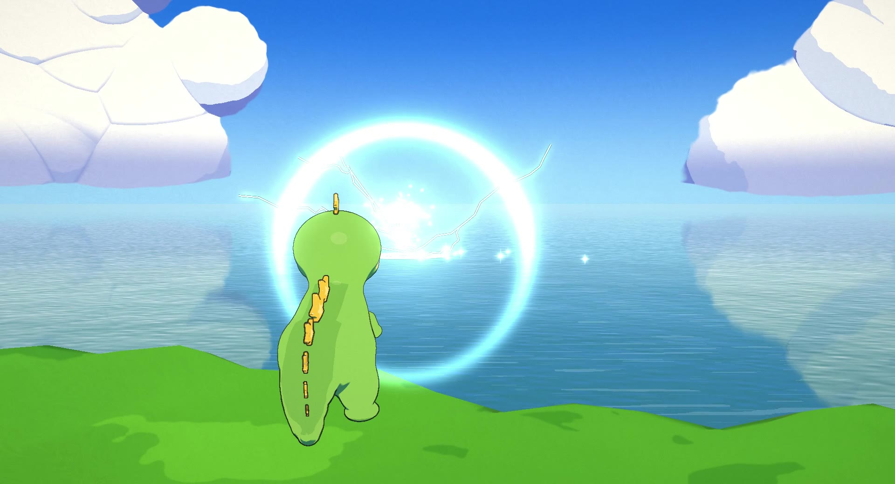
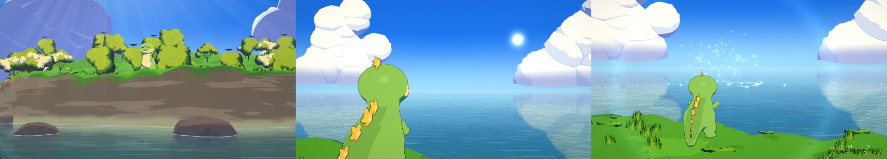
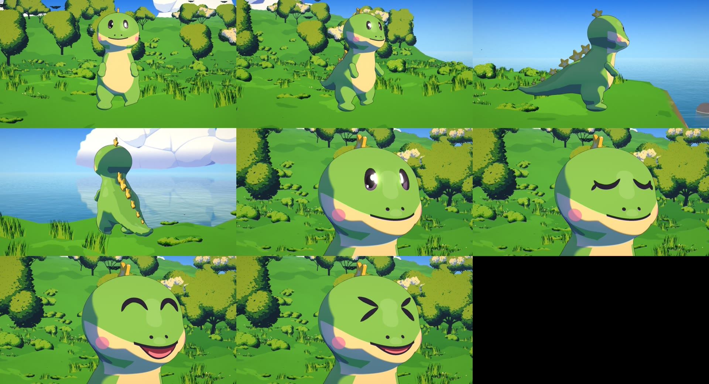

# 10 示例引擎 anime-core：使用说明与验证记录

`anime-core/` 是本研究的可运行产出：把 Sunshower / LEVIATHAN 的共用引擎抽象成**与故事无关的核心**，附带一部 8 秒原创示例短片《星のかけら / 星之碎片》（星星恐龙在海边岬角上看到星星碎片坠海，开心地跳起来）。代码约 3600 行，其中引擎核心约 2350 行（含 2026-11-05 补的有机建模层）。







## 10.1 目录

```
anime-core/
├── index.html            工作台（拖时间轴逐帧看；?scale=1 预览更快）
├── audio.html            配乐合成台（点 Render 试听，或给工具无头调用）
├── package.json          npm 脚本
├── vendor/               three.js r170 + 3 个 addon（MIT）
├── src/
│   ├── main.js           入口：boot(story)
│   ├── core/             ★ 引擎（换故事不改这里）
│   │   ├── engine.js     10 个 pass 的编排
│   │   ├── passes.js     笔触 / 描线 / 水面 / 大气 / 泛光 / 调色 着色器
│   │   ├── glsl.js       共享 uniform G、MRT 协议、噪声库
│   │   ├── materials.js  cel / paint / sky / glow / line 材质
│   │   ├── look.js       色彩脚本（两套调色板 k 插值）
│   │   ├── film.js       导演层：story → evalFrame(st)
│   │   ├── runtime.js    运行时：部门容错加载、URL 调试参数、window.FILM
│   │   ├── kit.js        硬表面建模：hull / cbox / superPts / blob / spike / starPlate / Rig / solve2
│   │   ├── organic.js    有机建模：SoftBody（SDF 并集 → Surface Nets）/ Skin（自动多骨骼蒙皮）/ surf / stroke
│   │   ├── face.js       动画眼睛：画出来的虹膜与高光、眼神朝镜头、闭眼/笑眼/眯眼笔画
│   │   ├── color.js      屏幕色 → 管线输入色（设定色所见即所得）
│   │   ├── fx.js         无状态特效：GlowBatch / LineBatch / Ripples / boltPts
│   │   └── util.js       确定性工具：hash / Rng / track / onTwos / onThrees / kick …
│   ├── story/            ★ 故事（换故事 = 换这个文件夹）
│   │   ├── story.js      CUES、镜头、look、state、部门清单
│   │   ├── world.js      环境部门：天空积云、岬角地形、岩石、灌木
│   │   ├── dino.js       角色部门：星星恐龙（一整张 SoftBody 皮 + 9 骨蒙皮、着色器花纹、表情、星形骨板）
│   │   └── fx.js         特效部门：流星、入水闪光、闪电、水滴、涟漪、闪点
│   └── audio/            程序化声音：dsp.js / score.js / soundtrack.js
├── tools/                check / snap / turnaround（设定图）/ determinism / render / render-audio / build-player
├── player/player.html    单文件播放器模板
├── docs/                 研究报告与交接文档（01–11，即本目录所在）
├── templates/            制片合同模板 / 新故事开工清单 / 故事骨架
├── out/<片名>/           （验证时生成，不入库）静帧、配乐、海报、MP4、render/ 分段
└── dist/star.html          （验证时生成，不入库）单文件成片 14.4 MB，双击即看
```

## 10.2 安装与运行

需要：Node 18+、Chrome（或 Chrome for Testing）、ffmpeg。

```bash
cd anime-core
npm install                          # 只装 puppeteer-core
export CHROME=/path/to/chrome        # 不在默认路径时
# Linux 默认用 swiftshader（慢但稳，像素基线按它生成）；有显卡时加 GPU=1（= ANGLE=gl + --enable-gpu，工具会打印实际 webgl 渲染器）；Windows 默认 d3d11

npx serve .                          # 浏览器打开 http://localhost:3000/index.html?scale=1 拖时间轴

npm run check                        # 加载检查：必须 ready: true + (no errors)
node tools/snap.mjs --scale 1 --sheet review s:hill s:gaze t:4.75 t:6.0
node tools/snap.mjs --scale 1 "q:test=1&cam=-8,2,-40&at=0,5,-4&fov=30&t=2=name:freecam"   # 自由机位
npm run model                        # 角色设定图：转面 + 表情表 → out/star/model/dino.jpg
npm run determinism                  # 确定性测试
npm run build                        # 配乐 → 整片 MP4 → dist 单文件播放器
```

> 如果未在项目本地安装 `puppeteer-core`，也可通过环境变量 `TOOLS_DIR=/path/to/global/node_modules_parent CHROME=/path/to/chrome` 指定外部依赖与浏览器路径。

## 10.3 验证记录（2026-11-05，WSL2 Linux，Chrome 157，SwiftShader 软件 WebGL）

| 检查 | 命令 | 结果 |
|---|---|---|
| 页面加载 | `node tools/check.mjs 120` | `ready: true {"frames":192,"fps":24,"shots":["hill","gaze","splash"]}`，`(no errors)`；SoftBody 网格化约 1 s（格子 74×136×154 → 36,278 顶点 / 72,552 三角形），`skin.update()` 每帧约 2 ms |
| 确定性 | `node tools/determinism.mjs 36 100 118 160` | 静态扫描无 `Math.random/Date.now`；4 帧在正序、倒序、全新页面会话下 SHA1 完全一致 |
| 设定图 | `npm run model` | 生成 `out/star/model/dino.jpg`（4 个转面 + 4 种表情，见页首图） |
| 配乐 | `node tools/render-audio.mjs` | 合成 0.8 s + 离线渲染 1.2 s；`ffprobe duration 8.000000 s`；频谱图与 CUES 对位（见下） |
| 整片 | `node tools/render.mjs --scale 1 --name star` | 4 段 × 48 帧；`h264 1920×1040 24fps 192 帧 8.000 s` + `aac 8.000 s`，10.5 MB |
| 播放器 | `node tools/build-player.mjs --video out/star/star.mp4 --out dist/star.html` | 14.2 MB；在 Chrome 中解码成功，`video.duration = 8`，无页面错误 |

**配乐频谱**（横轴 8 秒）：3.2 s 起流星呼啸的上扫斜线扎进 4.6 s 的入水低频冲击；冲击后音乐断开约 0.35 s（ducking）；5.6 s 与 6.7 s 两条上滑“啵嘤”正对两次起跳；结尾淡出。

## 10.4 视觉与音频自审方法

在纯代码动画工作流中，几何穿插、色彩过曝、高光杂斑、光线遮挡等问题很难仅凭阅读代码发现。因此标准开发循环固定为：
1. **角色设定图（`npm run model`）**：使用正面漫射打光输出 4 角度转面图（0°/45°/90°/180°）与表情特写表，检验轮廓剪影、接缝描线与眼神高光。
2. **镜头联系表（`tools/snap.mjs --sheet`）**：对每个镜头的首、中、尾帧批量出图并拼成总览图，直接通过多模态视觉检查构图、地平线切线、明暗交界与特效遮挡。
3. **几何与视线探针（`tools/probe.mjs`）**：用 `--check-cam`、`--check-sight`、`--collide` 自动检测各镜头中的视线遮挡与部件穿插。

## 10.5 做一部新故事（步骤）

1. **复制故事文件夹**：`cp -r src/story src/story-mytale`，把 `src/main.js` 的 import 改成新文件夹（或者保留多个故事，用不同入口）。
2. **写 CUES**（`story.js`）：6–12 个节拍，全部用秒。以后所有东西都引用它们。
3. **写镜头**：每个镜头 `{ name, start, end, cam(lt, d, t, st), look? }`。先用占位机位，让 `check` 和 `snap` 跑通。
4. **定 look**：`k`（0 柔光 ~ 1 晴空）、`sunElev / sunAz`、`key`（角色主光作弊方向）、`shadow`（角色阴影框）。想换整体色调就改 `presets`（两套调色板）。
5. **环境部门**（`world.js`）：天空团块 `[方位角, 仰角, 半径, 云底]`；地形用 `paintMaterial({ color, color2, rock, sand })`；导出 `terrain(x,z)` 给角色落脚。
6. **角色部门**（照 `dino.js`）：
   - **骨骼**：先用 `Rig.joint()` 搭静止姿态的骨骼。
   - **圆润的身体**：用 `SoftBody` 的 `ell / cone` 写图元，每个图元标明属于哪根骨头；然后 `build(material)`、`skin.bind(rig.j)`，每帧调用 `skin.update()`。
   - **花纹**：写 `celMaterial({ rest: true, pattern })`，按静止坐标画；表面上的定位点用 `body.project()` 求出来再传给着色器。
   - **眼睛**：用 `createEyes()`。
   - **硬质零件**：大角度转动的小肢体和硬质装饰，用独立网格挂在关节上。
   - **设定色**：经过 `screenAll()` 换算。
   - **收尾**：`rig.anchor()` 发布锚点；`pose(t)` 先 `onTwos(t)` 再算；`ctx.shadowRoots.push(root)`。
   - **检查**：每改一次造型，跑一次 `npm run model` 看转面图和表情表。
7. **特效部门**：`GlowBatch / LineBatch / Ripples / boltPts`；每帧 `begin → push → end`；水面附近用 `mode: 1`；亮背景上的线条加 `rim`。
8. **声音**：改 `src/audio/score.js` 的和声表、旋律、音效，全部引用 CUES。
9. **审片**：`check` → `snap --sheet` → 看图 → 改，循环。
10. **出片**：`npm run determinism && npm run build`。

如果要让 AI 团队并行做：先按 [08](08_AI多代理制作方法论.md) 和 [templates/](../templates/) 写 CONTRACT，再按部门分配文件。

## 10.6 已知局限（诚实说明）

- **有机建模层的限制：**
  - 蒙皮是线性混合：关节转 60° 以上会塌陷（糖纸效应），所以大角度的小肢体要做成独立网格；
  - 每帧在 CPU 上蒙皮，3.6 万顶点约 2 ms；
  - 网格化在加载时进行，约 1 秒；
  - Surface Nets 的分辨率由 `cell` 决定，比 2 个格子还细的结构会丢失（默认 3 cm）；
  - 花纹的区域划分要手写 GLSL 条件，还没有可视化的“画区域”工具。
- **只在 SwiftShader（CPU）上验证过**，约 2.3 s/帧（scale 1）。没有在 GPU 上测速；按原作数据，GPU 上 scale 2 约 0.4 s/帧。
- 水面是精简版：没有焦散、雨环场、尾迹、透射折射角计算；海洋是“近岸平静水面”，不是 LEVIATHAN 的千米海洋。
- 角色没有投影贴花、手写字、面板图集、aRest 风化（风化改用物体局部坐标近似）。
- 音频没有 LUFS 归一、限幅器、速度图、空间探测。
- render.mjs 没有源码哈希（改了代码后旧分段不会自动作废 —— 请加 `--force` 或删 `out/render/`）。
- 这些都列在 [09 §9.6](09_核心引擎设计蓝图.md) 的移植优先级里。
